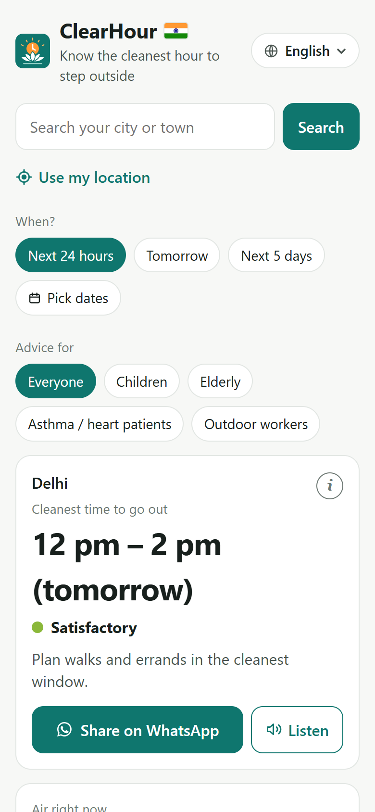
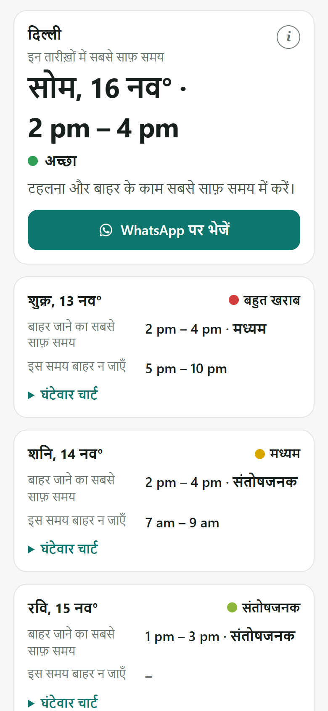
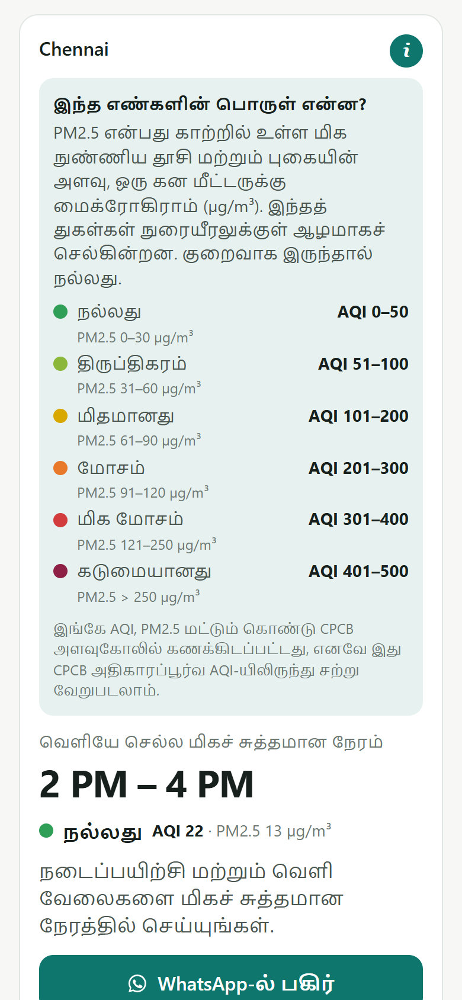

# ClearHour

**Know the cleanest hour to step outside, in your own language.**

ClearHour is a free web app that reads the air-quality forecast for any town in India and answers one practical question: *when today is the air cleanest to go outside, and when should I stay in?* It gives simple advice for children, the elderly, asthma and heart patients, and outdoor workers, in 11 Indian languages. It needs no app store, no sign-up and no API key.

| | |
|---|---|
| **Live app** | **[clearhour-india.vercel.app](https://clearhour-india.vercel.app)** |
| **Impact area** | Clean Air |
| **Hackathon** | Code for a Billion – Bharat Agentic-AI Hackathon 2026 (Code for India) |
| **License** | [MIT](LICENSE) |

<p>
  
  
  
</p>

---

## 1. Size of the problem

- **All of India, about 1.4 billion people, breathes air above the WHO guideline.** The Air Quality Life Index 2025 (EPIC, University of Chicago) finds every part of India above the WHO annual PM2.5 limit of 5 µg/m³, and about 46% of people live above even India's own standard of 40 µg/m³. ([AQLI 2025](https://epic.uchicago.in/all-of-india-breathes-bad-air-aqli2025-report-says/), [India fact sheet](https://aqli.epic.uchicago.edu/files/India%20FactSheet_2025_IndiaWV.pdf))
- **The people hit hardest are the ones least able to look up an AQI chart:** children, the elderly, asthma and heart patients, and the large informal workforce (street vendors, delivery riders, construction workers) who work outdoors.

## 2. Severity

- **1.67 million deaths in India in 2019** were linked to air pollution, **17.8% of all deaths** in the country. ([Pandey et al., *The Lancet Planetary Health*, 2021](https://pubmed.ncbi.nlm.nih.gov/33357500/))
- **US$36.8 billion lost in a year (1.36% of GDP)** through early deaths and illness (same study).
- **About 3.5 years of life lost** by the average Indian to polluted air, by AQLI 2025's estimate.

**Why existing tools don't solve this.** Pollution changes a lot through the day, but AQI apps show one number for *right now*. They are mostly in English and full of terms like "PM2.5 µg/m³". They need an app-store install, and they never answer what a family actually wants to know: *"When should my child play outside? When should I take my walk? When should I do heavy outdoor work?"*

## 3. Quality of the solution

### What a person sees

1. **Search** any city, town or village (typed in English *or* in their own script, e.g. दिल्ली, কলকাতা, சென்னை), **use their location**, or tap a popular city.
2. **The cleanest 2-hour window** between 6 AM and 10 PM, in large text, with its level (Good / Satisfactory / Moderate / Poor / Very poor / Severe).
3. **The hours to avoid** (Poor or worse), and **the air right now** with advice.
4. **Who the advice is for:** everyone, children, elderly, asthma / heart patients, outdoor workers. The tip changes accordingly.
5. **When:** next 24 hours, tomorrow, next 5 days, or any dates (up to 4–5 days ahead, or up to a year back). For several days there is one card per day plus the best day and time overall.

### Built for people who are not "app users"

| Need | What ClearHour does |
|---|---|
| Not comfortable in English | **11 languages**: English, Hindi, Gujarati, Marathi, Bengali, Tamil, Telugu, Kannada, Malayalam, Punjabi, Odia. All text is pre-translated, and an automated check confirms every text exists in all 11, so no translation service is called at runtime. |
| Finds reading hard | **Listen** reads the advice aloud in the chosen language with the phone's own voice. The button only appears if the phone has a voice for that language. |
| Confused by numbers | Main screen shows **time + level + plain advice only**. AQI and PM2.5 numbers sit behind a small ⓘ, which also explains what they mean. |
| Low-end phone, weak network | **Progressive Web App**: opens in any browser, can be added to the home screen, and shows the last saved forecast when offline. Small (about 85 kB of gzipped JavaScript). |
| Shares by WhatsApp | **One-tap WhatsApp message** in the chosen language, with the place, dates, best time, hours to avoid and advice. The link is short (e.g. `/?g=1273294&l=hi&f=child&w=d5`) and opens the same place, language, group and dates for the receiver. |
| First visit | A 30-second **guided tour** that asks first, shown once; tooltips on every control. |

### How it works

- **Built with:** this project was built in the [AgentFoundry IDE](https://agentfoundry.me), the official IDE of the Code for a Billion hackathon.
- **Forecast:** [Open-Meteo Air Quality API](https://open-meteo.com/en/docs/air-quality-api) (Copernicus CAMS model), hourly PM2.5, free and keyless.
- **Levels:** India's **CPCB National AQI** PM2.5 bands: Good ≤30, Satisfactory ≤60, Moderate ≤90, Poor ≤120, Very poor ≤250, Severe >250 µg/m³. The AQI number (0–500) is interpolated within each CPCB band from PM2.5.
- **Cleanest window:** for each day, the 2 consecutive awake hours (6 AM–10 PM) with the lowest average PM2.5. Hours that have already passed today are never suggested.
- **Advice:** fixed text written from CPCB health guidance. **No AI generates health advice at runtime, so it cannot hallucinate.**
- **Places:** Open-Meteo Geocoding (towns first, airports and stations filtered out). If a name typed in an Indian script isn't found, there is one fallback to OpenStreetMap Nominatim (settlements only). Device location is named with BigDataCloud's free client-side reverse geocoding.
- **Stack:** React 18, Vite 5, vite-plugin-pwa, one small Vercel serverless function ([api/count.js](api/count.js)) for the public counter.

### Privacy

- **No accounts, no cookies, no third-party tracking scripts.**
- **Location** (only if the user allows it) is sent only to fetch the forecast and the town name. Shared links round GPS to about 1 km.
- **The public counter** stores only totals, plus a salted hash of the IP for one day so the same person is not counted twice.

### Testing done

Automated browser tests on a 360 px phone screen, in all 11 languages: search in each language's own script, the forecast, the first-visit tour, the ⓘ panels, the 5-day and custom-date views, the spoken text, the WhatsApp message and link, and opening a shared link on a fresh device. No layout overflow and no script errors were found. The counter function was tested against a mock database: duplicate visits from the same IP are not counted, bad requests are rejected, and raw IPs are never stored.

## 4. Proven impact

ClearHour shows a **public counter to every visitor**: *"Checked N times so far · P% of M people said it helped"*. The numbers come from real use, are counted at most once per device and IP per day, and the helpful percentage appears only after 5 answers.

_Fill in with real numbers on the day you submit:_

| Metric | Value | Source |
|---|---|---|
| Visits (once per device per day) | | Counter on the live site |
| "Was this helpful?" answers | | Counter |
| % who said it helped | | Counter |
| Cities checked | | |
| People who changed when they went out | | Follow-up messages / form |

**What users said**

- _"…" — name or role, city_
- _"…" — name or role, city_

## Honest limitations

- **Model forecast, not ground sensors.** CAMS is a regional model, so very local sources (a busy road next door, a fire) may not show up. The app says this on every screen.
- **Hourly use of CPCB bands.** CPCB defines its bands on 24-hour averages and its official AQI on several pollutants. ClearHour applies the PM2.5 bands hourly as a practical guide and says its AQI can differ slightly from the official one.
- **Forecast range.** Only about 4–5 days ahead are available, so dates further out cannot be picked. The ⓘ next to the date picker explains why.
- **Translations** were drafted for this project. Reviewed by native speakers so far: _list languages_. Corrections are welcome as issues or pull requests.
- **Listen** depends on the voices installed on the phone. Most Android phones have Indian-language voices, but not all.
- **General guidance, not medical advice.**

## Run locally

```bash
npm install
npm run dev      # http://localhost:5173
npm run build    # production build in dist/
```

## Deploy (Vercel)

1. Import this repository at [vercel.com/new](https://vercel.com/new). The framework preset is Vite; no settings or keys are needed.
2. **Public counter (recommended):** in the Vercel project open **Storage → Create Database → Upstash (Redis)** (free), connect it to this project, then **Redeploy**. Vercel adds the database variables automatically. Without it the app works fully and the counter stays hidden.

## Project structure

```
src/App.jsx     UI: search, date picker, results, chart, tour, sharing, listen
src/aqi.js      Forecast, CPCB levels and AQI, cleanest-window logic, place search
src/i18n.js     All text in 11 languages
src/track.js    Talks to the public counter
api/count.js    Vercel function: public counter (Upstash Redis)
public/         App icon (lotus + morning sun with clock hands) and PWA icons
docs/           Screenshots used in this README
```

## Data sources and credits

- Air quality: [Open-Meteo](https://open-meteo.com/) / [Copernicus Atmosphere Monitoring Service](https://atmosphere.copernicus.eu/)
- Places: [Open-Meteo Geocoding](https://open-meteo.com/en/docs/geocoding-api) (GeoNames), [OpenStreetMap Nominatim](https://nominatim.org/) (© OpenStreetMap contributors), [BigDataCloud](https://www.bigdatacloud.com/)
- Air-quality bands: Central Pollution Control Board (CPCB), National Air Quality Index
- Health and economic figures: AQLI 2025; *The Lancet Planetary Health* (2021)

## License

[MIT](LICENSE). Free for any NGO, school, city or government body to use and adapt.
